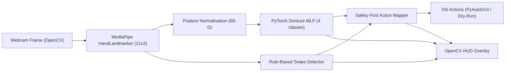

# System Architecture

## Pipeline Overview

## Module Responsibilities
- `tghci.config`: YAML configuration loading and `--check` environment probe.
- `tghci.tracker`: MediaPipe Tasks `HandLandmarker` wrapper returning 21x3 landmarks, handedness, and confidence.
- `tghci.features`: Translation/scale-invariant landmark normalisation, left-hand mirroring, and auxiliary geometric ratios.
- `tghci.collect` & `tghci.dataset`: Session-tagged CSV recording, schema validation, and session-based train/val/test splitting.
- `tghci.model` & `tghci.train`: Configurable PyTorch MLP classifier, deterministic training, early stopping, and checkpoint metadata.
- `tghci.swipe`: Sliding-window trajectory heuristic for left/right swipe detection.
- `tghci.actions`: Disarmed-by-default, debounced, cooldown-gated OS action mapper with dry-run mode.
- `tghci.app` & `tghci.overlay`: Real-time HUD rendering and webcam loop.
- `tghci.benchmark` & `tghci.evaluate`: CPU vs GPU latency benchmarking and held-out session evaluation.

## References Used
- MediaPipe Hand Landmarker float16 model asset: `https://storage.googleapis.com/mediapipe-models/hand_landmarker/hand_landmarker/float16/1/hand_landmarker.task`
- PyTorch CUDA 12.8 wheel index: `https://download.pytorch.org/whl/cu128`
